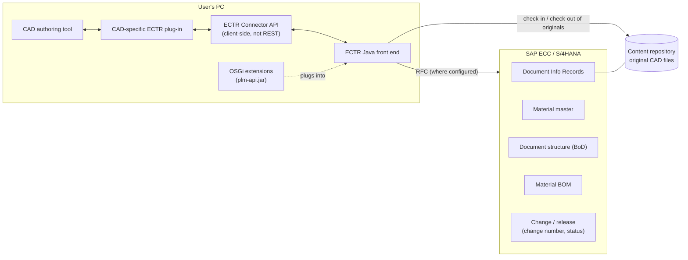
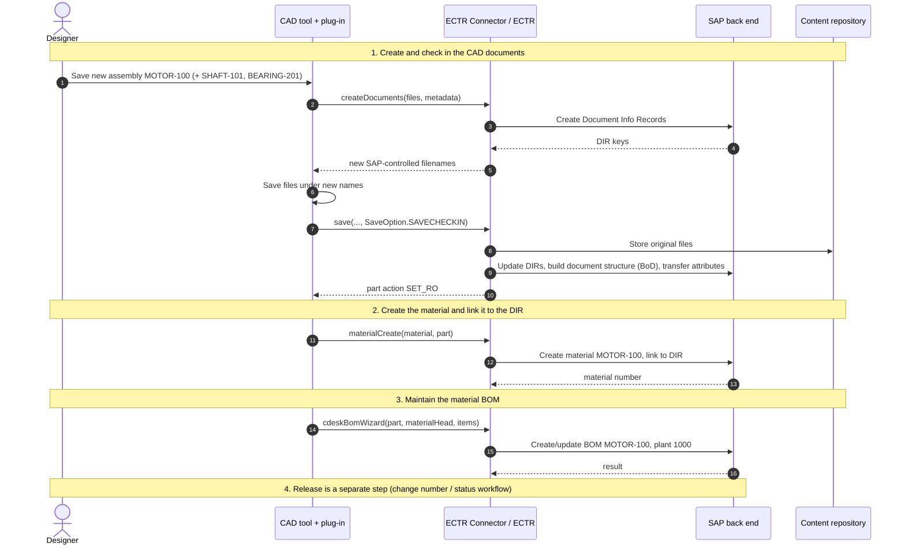

# Architecture A: CAD → SAP ECTR → SAP back end (ECC or S/4HANA)

> **Learning material.** SAP ECTR method names below come only from the SAP ECTR Connector how-to pages on the SAP Help Portal ([Connector API documentation](https://help.sap.com/docs/SUPPORT_CONTENT/plm/3363506386.html)). Anything else is described in words, not invented as API.

## 1. What this architecture is

SAP ECTR (SAP Engineering Control Center) integrates **authoring tools on the user's desktop** with the PLM functions **inside** SAP ECC or S/4HANA. There is no separate "PLM server" in between: document management, material master, BOM and change management are SAP modules.

| Component | Where it runs | Role |
|---|---|---|
| CAD authoring tool | User's PC | NX, Creo, SOLIDWORKS, CATIA V5, Inventor, AutoCAD, Solid Edge, EPLAN, … |
| CAD-specific ECTR plug-in | Inside the CAD tool | SAP menus/ribbon; sends files, metadata and structure to ECTR |
| **ECTR Connector API** | User's PC (client-side Java/.NET library) | For building a **custom** authoring-tool integration. **Not a REST API**: a browser or remote service cannot call it. |
| **ECTR OSGi API** (`plm-api.jar`) | Inside the ECTR Java front end | For **extending ECTR itself**: custom user actions, Object Browser tabs, windows, file handlers, and RFC calls through the `RfcExecutor` service |
| ECTR Java front end | User's PC | SAP logon, dialogs, session directory, cache; talks to the back end |
| SAP back end | ECC 6.0 EHP7+ or S/4HANA 1809+ | DIR, material master, BoD, BOM, change records, classification |
| Content repository | SAP Content Server (or BTP Document Management Service where configured) | Stores the original CAD files |

ECTR talks to the back end through RFC (ECTR back-end function modules in the `/DSCSAG/` namespace) where it is configured that way. The exact connectivity depends on your ECTR release and installation.

## 2. Architecture diagram

## 3. Four separate things, not one

A frequent misunderstanding is "saving the assembly in CAD creates the production BOM". It does not. These are **distinct operations**, each with its own SAP object, authorization and status:

| # | Operation | SAP object | Triggered by |
|---|---|---|---|
| 1 | Create / check in a CAD document | Document Info Record + original file on the content repository | ECTR save / check-in |
| 2 | Store the CAD assembly structure | Document structure (**Bill of Documents, BoD**) | ECTR check-in of an assembly |
| 3 | Create the part number | **Material master**, linked to the DIR | `materialCreate(...)`, or manually / by a separate process |
| 4 | Create / update the **material BOM** | Material BOM (engineering or manufacturing usage, per configuration) | `cdeskBomWizard(...)`, a BoD→BOM transfer, or manual BOM maintenance |

Even after step 4, the BOM is **not automatically released for production**. Release normally follows your engineering change / status process (change number, DIR status, BOM status) and may need a separate manufacturing BOM.

## 4. Sequence: check in a CAD document, then material and BOM

Scenario: assembly **MOTOR-100**, revision **B**, plant **1000**, with **SHAFT-101 × 1** and **BEARING-201 × 2**.

`createDocuments`, `save` and `SaveOption.SAVECHECKIN` come from the "How to create new documents with ECTR-Connector" and "How to save documents with ECTR-Connector" pages. `materialCreate` and `cdeskBomWizard` come from "How to create materials …" and "How to maintain BOM …".

## 5. Java example (ILLUSTRATIVE PSEUDOCODE)

See [`../ectr-pseudocode/EctrMaterialAndBomExample.java`](../ectr-pseudocode/EctrMaterialAndBomExample.java).

It is **deliberately not part of the Maven build**. It compiles only against the ECTR toolkit from a real ECTR installation, with a working ECTR session, application type and license. Class and method names follow the SAP how-to pages. Check exact packages and signatures in your toolkit Javadoc (`<ECTR_INSTALLATION>/basis/toolkit/<CONNECTOR_ZIP>/java/javadoc/com/dscsag/plm/comm/PlmConnector.html`).

## 6. Prerequisites for a real ECTR integration

| Area | What you need |
|---|---|
| Versions | Matching CAD release, ECTR interface release, ECTR release, SAP GUI and OS. Check the **Product Availability Matrix (PAM)** for SAP ECTR. |
| Existing interface? | If SAP or a partner already ships an ECTR interface for your CAD tool, **use it**. SAP says not to build on the Connector API in that case. |
| Toolkit / Javadoc | `<ECTR_INSTALLATION>\basis\toolkit` (installed by default since ECTR 5.1.13.0; earlier versions need installer parameter `/InstallToolkit`). OSGi: `basis/classes/plm-api.jar` and `basis/toolkit/plm-api-javadoc.zip`. Match the plm-api version to your ECTR release. |
| Application type | Every integrated application needs its own application type (directory under ECTR `applications`) and license key. |
| License | Custom Connector integrations are licensed as SAP ECTR Professional (Unit ID 7523). See SAP Note 2096135. |
| SAP configuration | Document types, workstation applications, content repository / storage, number ranges, material types, BOM usage, status networks and change management for your process. |
| Attribute mapping | ECTR attribute mapping files (for example `attributes-to-sap.xml` / `attributes-from-sap.xml`) for CAD ↔ SAP fields |
| Connectivity and credentials | Users log on to SAP through ECTR with their own SAP user and authorizations. Never hard-code credentials in plug-in code. |

## 7. Typical failures and where to look

| Symptom | Likely cause | Where to look |
|---|---|---|
| Plug-in can't connect to ECTR | ECTR not running, wrong application type, plug-in/ECTR version mismatch | ECTR front-end log / debug files in the ECTR user directory, CAD plug-in log |
| "License" or "application not allowed" | Missing license key or application type | ECTR Customizing, license configuration |
| DIR creation fails | Document type, number range, authorization, or required fields missing | ECTR **API log** (shows each RFC call with inputs, outputs and runtime), SAP message in the ECTR dialog, `SU53` for authorization, `ST22` for dumps |
| Check-in fails / file missing | Content repository not reachable, wrong storage category, locks | ECTR log, content server / repository configuration (`OAC0`), `SLG1` application log if used |
| Material or BOM not created | Material type / plant / BOM usage not configured, component material does not exist, missing change number | ECTR API log, SAP return messages (BAPIRET2), `SLG1`, `ST22` |
| Wrong or stale file opened | Cache issue | ECTR cache settings. Review SAP Note **3503146** (Cache Server caching wrong content). |
| Everything slow | Large structures, cache size, network latency | ECTR API log runtimes, `ST05`/`STAD` on the SAP side |

Transaction codes above are standard SAP tools. Which logs exist and where depends on your release and configuration.
