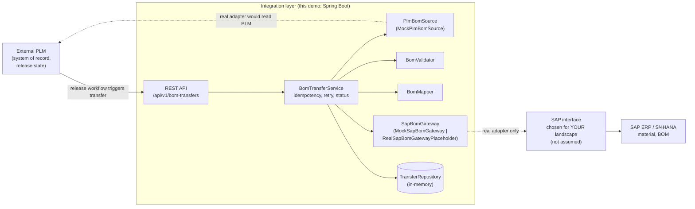
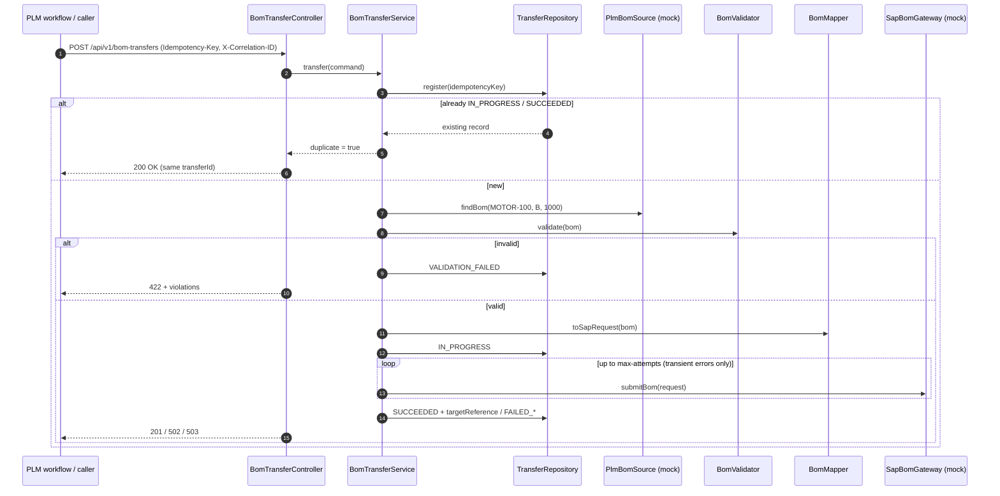

# Architecture B: External PLM → integration layer → SAP ERP / S/4HANA

> **Learning material.** The code in `backend/` implements this architecture with **mock adapters only**. No SAP interface, endpoint or payload schema is assumed to exist in your landscape.

## 1. How this differs from Architecture A

| | Architecture A (CAD → ECTR → SAP) | Architecture B (External PLM → SAP) |
|---|---|---|
| Who owns engineering data? | SAP itself (DIR, BoD, BOM live in SAP) | The **external PLM** (Teamcenter, Windchill, 3DEXPERIENCE, …) |
| Where is the release decision made? | SAP change/status process | **In the source PLM**. SAP receives already-released data. |
| Integration point | Desktop: CAD plug-in ↔ ECTR client | Server-to-server: PLM ↔ integration layer ↔ SAP interface |
| Typical trigger | Designer saves / checks in | PLM workflow step (e.g. "Release to ERP") |
| API style | Client-side Connector / OSGi Java API | Whatever the SAP and PLM versions support (see §4) |

## 2. Responsibilities

1. **The source PLM** owns engineering data and release state. Only RELEASED data is sent.
2. **The integration adapter** reads the BOM, **validates** it (release state, quantities, duplicates, mandatory fields) and **maps** it to the target contract (item numbers, units, BOM usage).
3. **The SAP adapter** calls the SAP integration interface that is **actually configured** in your landscape.
4. **The integration records transfer state** (received → in progress → succeeded / failed), the attempts made, the SAP response identifier, and the correlation ID.

## 3. Architecture diagram

## 4. Synchronous vs asynchronous options

None of these is assumed to be available. Choose based on your SAP release, licenses, PLM product and middleware.

| Style | Examples (availability varies by version and license) | Good for | Watch out for |
|---|---|---|---|
| **Synchronous API** | SAP OData/REST APIs, BAPI/RFC via SAP JCo, an SAP PLM integration add-on with an HTTP interface | Immediate feedback to the PLM workflow, low volume | Timeouts, SAP availability coupling, rate limits. Needs retry and idempotency. |
| **Asynchronous / middleware** | IDoc (e.g. BOM/material message types) via ALE, SAP Integration Suite, other ESB/iPaaS, message queues | High volume, decoupling, guaranteed delivery | Status comes back later. You need a callback or polling and correlation of responses. |
| **Vendor connector** | Connectors sold by the PLM vendor or partners | Faster start, supported mappings | Licensing, customization limits |

The demo's `SapBomGateway` interface hides this choice. Business logic (validation, mapping, idempotency, status) stays the same whichever transport you pick.

## 5. Sequence (as implemented in the demo)

## 6. Error handling rules

| Situation | Status | HTTP | Retried? |
|---|---|---|---|
| Bad request body (format, plant not 4 chars, …) | (no record) | 400 | No: fix the request |
| BOM not in PLM | `VALIDATION_FAILED` | 404 | No |
| BOM not released / invalid quantity / duplicate component | `VALIDATION_FAILED` | 422 | No: fix the data in PLM, then resubmit |
| SAP timeout / unavailable (`SapTransientException`) | retried; then `FAILED_TRANSIENT` | 503 | Yes, up to `TRANSFER_MAX_ATTEMPTS` with linear backoff |
| SAP rejects data (`SapPermanentException`) | `FAILED_PERMANENT` | 502 | No |
| Same Idempotency-Key while `IN_PROGRESS`/`SUCCEEDED` | unchanged | 200, `duplicate: true` | SAP is not called again |
| Same key after a `FAILED_*` / `VALIDATION_FAILED` | new attempt | as above | Allowed |

**Idempotency:** callers should send an `Idempotency-Key` header (for example the PLM workflow task ID). Without it, the key is derived from the business key `BOM:<material>:<revision>:<plant>`. A real SAP adapter should also pass the key to SAP if the target interface supports it, because the integration layer alone cannot prevent duplicates after a timeout where SAP actually committed.

**Correlation:** every request gets an `X-Correlation-ID` (taken from the caller or generated). It appears in the response header, the error body, the transfer record and every log line.
