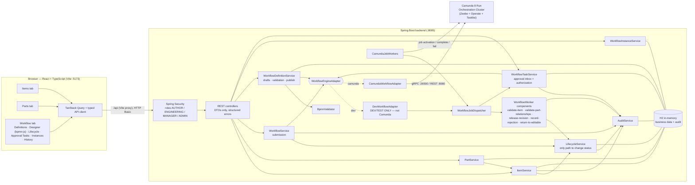
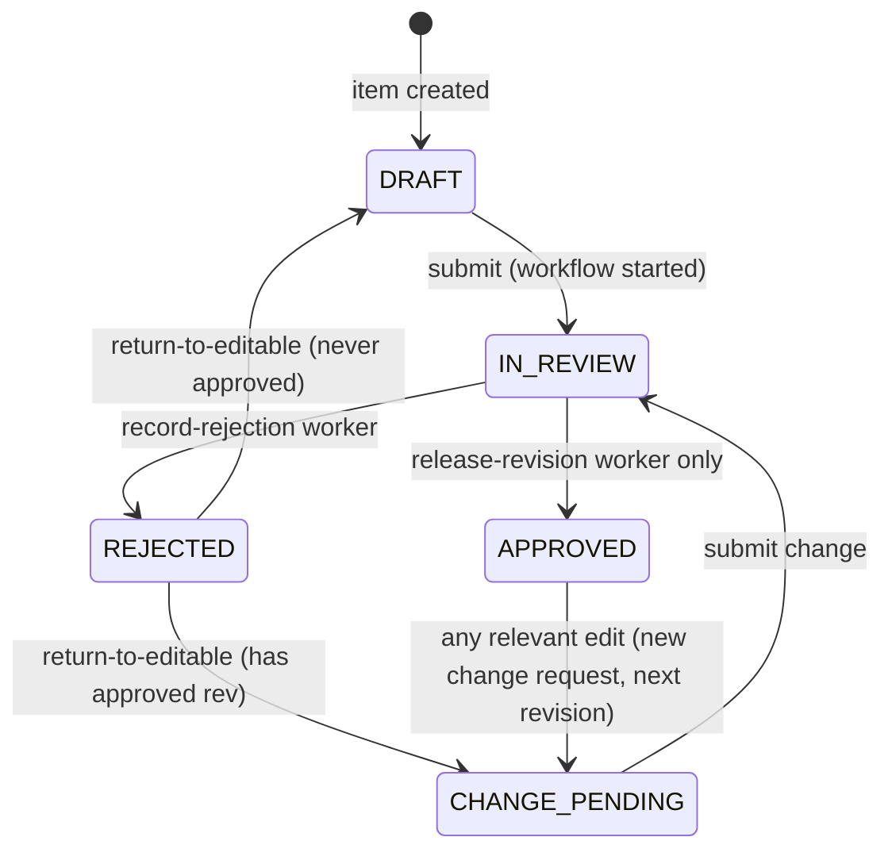
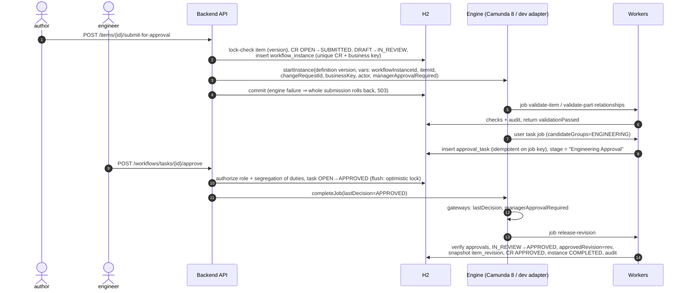

# Architecture

## 1. Component diagram



**Key boundaries**

- The **browser** talks only to the backend's REST API. It never sees engine endpoints or engine credentials.
- **`WorkflowEngineAdapter`** is the only engine-facing interface used by business code:
  `deploy`, `startInstance`, `completeUserTask` and `retry`.
- **`WorkflowJobDispatcher`** is the only entry point *from* the engine: service jobs go to workers, and user-task jobs go
  to the task inbox. Both adapters call it, so business behaviour is identical on Camunda and on the dev adapter.
- **`LifecycleService`** is the only code that can change `Item.lifecycleStatus`. `Item` has no setter for it.
  `Item.applyTransition` needs a `TransitionPermit`, and only `LifecycleService` (in another package) can construct
  one. Every transition is checked against the configured `lifecycle_transitions` table and audited.

## 2. Data model

```mermaid
erDiagram
  ITEMS ||--o{ ITEM_PARTS : "bill of materials"
  PARTS ||--o{ ITEM_PARTS : "used in"
  ITEMS ||--o{ CHANGE_REQUESTS : "has"
  ITEMS ||--o{ ITEM_REVISIONS : "approved snapshots"
  CHANGE_REQUESTS ||--o| WORKFLOW_INSTANCES : "submitted as (unique)"
  WORKFLOW_DEFINITIONS ||--o{ WORKFLOW_DEFINITION_VERSIONS : versions
  WORKFLOW_DEFINITION_VERSIONS ||--o{ WORKFLOW_INSTANCES : "runs on"
  WORKFLOW_INSTANCES ||--o{ APPROVAL_TASKS : "user tasks"
  WORKFLOW_INSTANCES ||--o{ WORKFLOW_EVENTS : audit

  ITEMS { bigint id PK; string item_number UK; string name; string lifecycle_status; string revision; string approved_revision; bigint version "optimistic lock" }
  PARTS { bigint id PK; string part_number UK; string name; string part_type; bigint version }
  ITEM_PARTS { bigint id PK; bigint item_id FK; bigint part_id FK; int quantity; int position; uk "item_id+part_id" }
  CHANGE_REQUESTS { bigint id PK; bigint item_id; string status "OPEN SUBMITTED APPROVED REJECTED"; string base_revision; string target_revision; clob change_log; string rejection_reason; bigint version }
  ITEM_REVISIONS { bigint id PK; bigint item_id; string revision "uk item+revision"; string name; clob parts_json; timestamp approved_at; string approved_by }
  WORKFLOW_DEFINITIONS { bigint id PK; string workflow_key UK; string workflow_type; boolean active }
  WORKFLOW_DEFINITION_VERSIONS { bigint id PK; string workflow_key; int version_number; string status "DRAFT PUBLISHED SUPERSEDED"; clob bpmn_xml; clob rules_json; bigint engine_process_definition_key }
  WORKFLOW_INSTANCES { string id PK "UUID"; bigint engine_instance_key; string business_key UK; bigint change_request_id UK; string status; string current_stage; boolean manager_approval_required }
  APPROVAL_TASKS { bigint id PK; bigint engine_job_key UK; string candidate_group; string status; string decision_by; string decision_comment; bigint version }
  LIFECYCLE_TRANSITIONS { bigint id PK; string from_status; string to_status "uk from+to"; boolean enabled; boolean system }
  WORKFLOW_EVENTS { bigint id PK; timestamp ts; string actor; string action; string business_key; string workflow_instance_id; string summary }
```

The dev adapter keeps its own execution state in `dev_engine_deployments` and `dev_engine_instances`. With Camunda, that
state lives inside Camunda.

## 3. Lifecycle



- These transitions are rows in `lifecycle_transitions` and are configurable in Workflow → Lifecycle States. Disabling
  one, for example `DRAFT → IN_REVIEW`, immediately blocks that move, including when a worker attempts it.
- No REST endpoint accepts a status. The *only* path to `APPROVED` is the `release-revision` worker. Before releasing,
  it re-verifies from the application's own records that every required approval was granted:
  - no task is open
  - no task was rejected
  - each `requiredRoles` entry has an approval
  - there is a MANAGER approval if `managerApprovalRequired`

## 4. End-to-end execution (submit → approve → release)



**Rejection path.** The approver rejects with a mandatory reason, and the decision variables route the process to
`record-rejection`, which:

- marks the item `REJECTED`, the change request `REJECTED` and the instance `REJECTED`
- stores the reason

Then `return-to-editable` moves the item to `DRAFT` or `CHANGE_PENDING` and opens a fresh change request for the rework.
The previously approved revision is never touched.

**Change after approval.** Any relevant edit to an `APPROVED` item does three things:

- moves it to `CHANGE_PENDING`
- bumps the working revision (A → B)
- opens a new change request based on revision A

The item list shows "B (approved A)", and the Approved revision tab shows the immutable snapshot of A. Editing only a
part's own attributes doesn't touch item lifecycles. Changing *which items use a part* only affects the items whose
membership actually changed.

## 5. Consistency and concurrency

| Concern | Mechanism |
|---|---|
| Concurrent item edits | `@Version` on Item and Part, plus an explicit version check on PUT. The loser gets 409. |
| Duplicate workflow start | Four layers: (1) only an OPEN change request can be submitted; (2) the item's optimistic lock means only one concurrent submit can move it to IN_REVIEW; (3) a unique `workflow_instances.change_request_id`; (4) a unique `business_key = ITEM-{itemId}-CR-{crId}`. |
| Duplicate or concurrent approval | `ApprovalTask` has `@Version`. The decision is flushed (row lock + version check) **before** the engine is called, so a second decision fails with 409 and never reaches the engine. |
| At-least-once job delivery | Every worker is idempotent. Release no-ops if the CR is already APPROVED, rejection no-ops if already REJECTED, and inbox registration is unique on the engine job key. |
| Worker vs. submit race (Camunda) | Workers look up the instance by `workflowInstanceId`. If the submitting transaction isn't visible yet, they throw `RetryableWorkflowException` and the engine retries after backoff. |
| Engine call failure | Submission, publish and decision call the engine **inside** the DB transaction. On engine failure everything rolls back and the API returns 503. |
| Worker failure | The job fails with decremented retries and backoff. At zero retries the engine raises an incident, the instance becomes `INCIDENT` and `WORKFLOW_FAILED` is audited in a separate transaction. An admin can **Resolve & retry**. |
| Audit integrity | Audit rows are written in the same transaction as the business change (`Propagation.MANDATORY`), so they can't diverge. Failure events use `REQUIRES_NEW` so they survive the rollback. |

## 6. Workflow definitions and versions

- A definition (`workflow_definitions`) has many versions. The editable version is `DRAFT`. **Publish** does four
  things:
  - validates the BPMN with `BpmnValidator`
  - deploys it through the adapter
  - stores the engine's process definition key
  - marks the previous published version `SUPERSEDED`
- New submissions use the active definition's published version. Running instances keep the version they started on;
  `definitionVersion` is shown in the instance list and on each task.
- **Validation covers:**
  - the process id equals the key, and the process is executable
  - a single none start event and at least one end event
  - every service-task job type has a registered worker
  - user tasks have a known candidate group and are job-worker based
  - gateway flows have conditions or a default flow
  - every element is reachable
  - with the dev adapter: only the supported BPMN subset and the FEEL-lite syntax
  - warnings when no `release-revision` task is present
- **Approval rules** (stored per version) add configuration on top of the BPMN:
  - `managerApproval`, one of: `ALWAYS` / `NEVER` / `WHEN_PARTS_REMOVED` / `WHEN_PREVIOUSLY_APPROVED` /
    `WHEN_PART_CHANGES_EXCEED` (with a threshold). The backend evaluates it at start and passes it to the process as
    `managerApprovalRequired`.
  - `requiredRoles`, re-checked by the release worker.
  - `dueInDays` for task due dates.
  - `preventSelfApproval`: a submitter can't approve their own change.
- Process variables available to conditions:
  - `lastDecision` and `lastDecisionBy`
  - `<elementId>Decision`
  - `rejectionReason`
  - `validationPassed` and `validationMessage`
  - `managerApprovalRequired`
  - `itemNumber` and `revision`

## 7. Engine adapters compared

| | `CamundaWorkflowAdapter` | `DevWorkflowAdapter` |
|---|---|---|
| Purpose | Real orchestration | Local development and automated tests **only** |
| Engine | Camunda 8 Orchestration Cluster (C8 Run, Self-Managed or SaaS) | In-process, single-threaded interpreter |
| BPMN coverage | Full Camunda 8 BPMN and FEEL | None start/end events, service tasks, job-worker user tasks, exclusive gateways, simple FEEL comparisons |
| Execution state | Inside Camunda (its own storage) | `dev_engine_*` tables in H2 |
| Jobs | Camunda job workers (`CamundaJobWorkers`) | Same `WorkflowJobDispatcher`, invoked after commit |
| Retries and incidents | Camunda fail command with retries and backoff; incidents | Same semantics, simulated |
| Monitoring | Camunda Operate plus the app's Instances view | The app's Instances view |
| Identification | `engine = CAMUNDA_8`, header badge "Camunda 8 · connected" | `engine = DEV_ADAPTER`, amber badge "Dev workflow adapter — not Camunda", startup WARN log |
